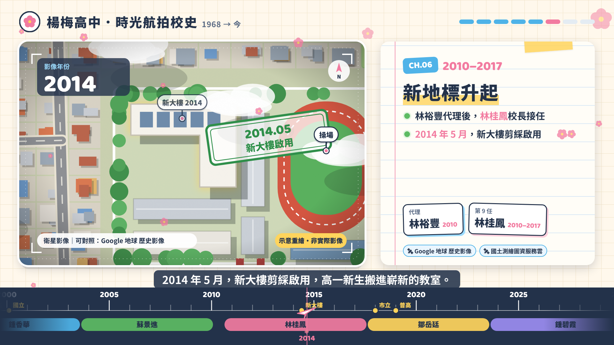

# 楊梅高中．時光航拍校史（Motion Showreel 網頁）

用單一 HTML 檔加內嵌 SVG 做成、可以像影片一樣播放的校史解說網頁。用空中俯瞰的視角，從 **1968 年省立楊梅高中成立** 一路看到今天。

## 規格
| 項目 | 內容 |
|---|---|
| 檔案 | `index.html`（單一檔案，畫面全部是內嵌 SVG＋HTML） |
| 時長 | 300 秒，共 8 章，另有片頭、片尾 |
| 畫幅 | 1920×1080 舞臺，會依視窗大小等比縮放 |
| 風格 | 青春校園風：筆記本方格紙、紙膠帶、梅花花瓣、手帳卡片翻頁 |
| 配樂 | Web Audio 即時原創合成，96 BPM。調性隨年代往上走（F → G → A），編制也一章一章變豐富 |
| 音效 | 程式合成：翻頁、轉場風切聲、年份滴答聲、里程碑鈴聲、蓋章聲 |
| 旁白 | 瀏覽器內建語音（zh-TW），語速 1.15；旁白播放時配樂會自動壓低 |
| 互動 | 播放／暫停、進度列拖曳、章節跳轉、字幕／旁白／音樂開關、全螢幕；地圖圖釘可以點；卡片上有真實圖資連結 |

快捷鍵：空白鍵＝播放／暫停，←／→＝倒退／快轉 5 秒，F＝全螢幕。網址加上 `?t=秒數` 可以直接跳到指定時間。

## 內容範圍
- 只講 1968 年之後的楊梅高中，**不使用楊梅國中（原縣立楊梅中學）的史料與圖資**。
- 空中俯瞰畫面是**依校史文字重新繪製的示意圖**。早年的畫面是黑白航照風格，越接近現代顏色越飽和，城市也越來越密。Google 地球、Google 地圖的影像受授權限制，不能嵌入網頁，所以在頁面的「資料來源・真實圖資」裡附上 Google 地球歷史影像、國土測繪圖資服務雲、中研院臺灣百年歷史地圖的連結，方便對照真實影像。
- 待查證：鍾香華、蘇景進兩位校長的任期，各資料記載不同；校舍棟數、位置與興建年份都是示意，只有「2014 年 5 月新大樓啟用」有學校文字依據。

## 怎麼使用
直接用瀏覽器開啟 `index.html`，或用 GitHub Pages 發佈（Settings → Pages → 選擇分支與根目錄）。
